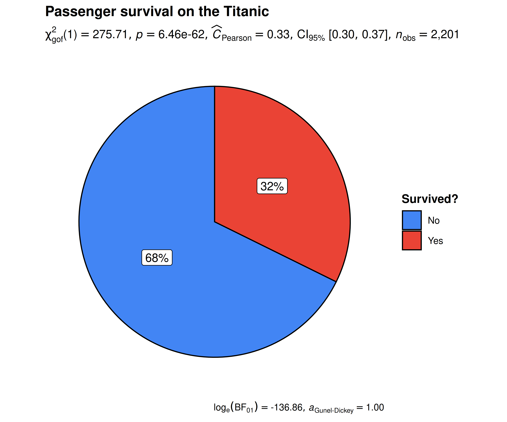
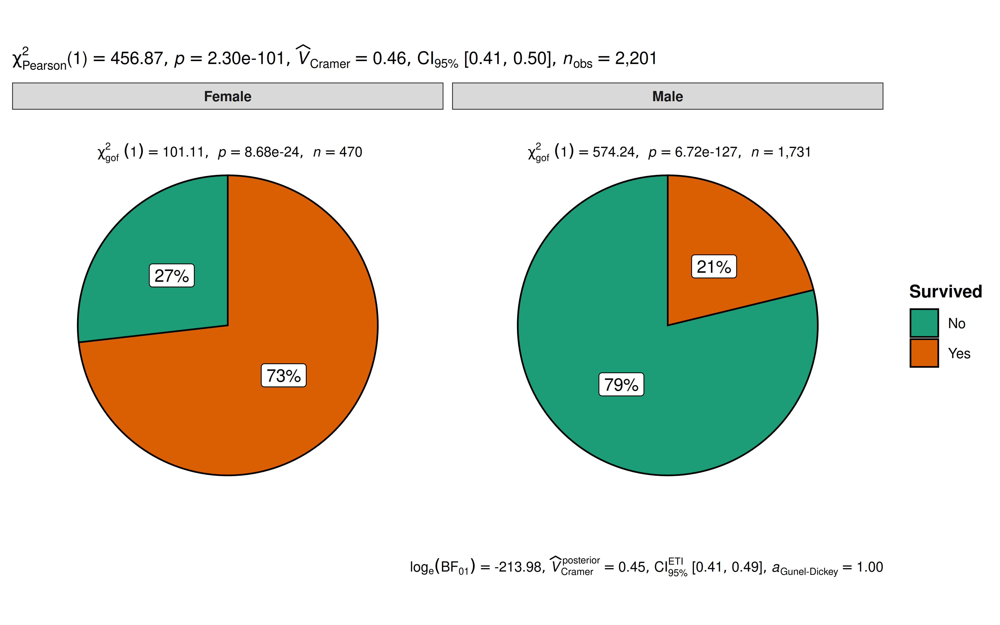
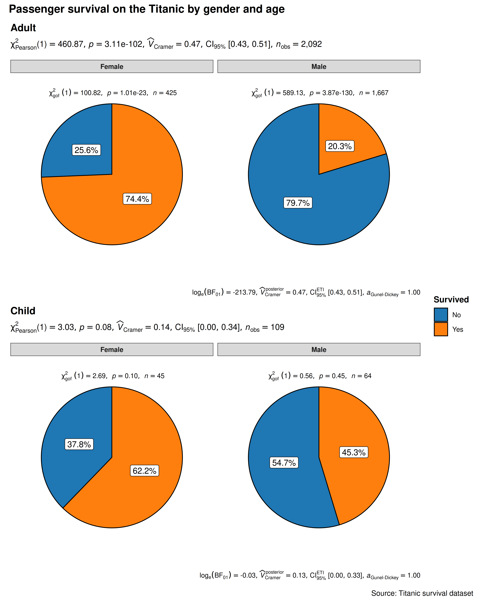

# ggpiestats

------------------------------------------------------------------------

Lifecycle:
[](https://lifecycle.r-lib.org/articles/stages.html)

## Introduction to `ggpiestats`

The function `ggpiestats` can be used for quick **data exploration**
and/or to prepare **publication-ready pie charts** to summarize the
statistical relationship(s) among one or more categorical variables. We
will see examples of how to use this function in this vignette.

To begin with, here are some instances where you would want to use
`ggpiestats`-

- to check if the proportion of observations matches our hypothesized
  proportion, this is typically known as a “Goodness of Fit” test

- to see if the frequency distribution of two categorical variables are
  independent of each other using the contingency table analysis

- to check if the proportion of observations at each level of a
  categorical variable is equal

`ggpiestats` works **only** with data organized in data frames or
tibbles. It will not work with other data structures like base-R tables
or matrices. It can operate on data frames that are organized with one
row per observation or data frames that have one column containing
counts. This vignette provides examples of both (see examples below).

To help demonstrate how `ggpiestats` can be used with categorical (also
known as nominal) data, a modified version of the original `Titanic`
dataset (from the `datasets` package) has been provided in the
[ggstatsplot](https://www.indrapatil.com/ggstatsplot/) package with the
name `Titanic_full`. The Titanic Passenger Survival Dataset provides
information “on the fate of passengers on the fatal maiden voyage of the
ocean liner *Titanic*, including economic status (class), sex, age, and
survival.”

Let’s have a look at the structure of both.

\
`# looking at the original data in tabular format`\
`dplyr``::`[`glimpse`](https://pillar.r-lib.org/reference/glimpse.html)`(``Titanic``)`\
`#>  'table' num [1:4, 1:2, 1:2, 1:2] 0 0 35 0 0 0 17 0 118 154 ...`\
`#>  - attr(*, "dimnames")=List of 4`\
`#>   ..$ Class   : chr [1:4] "1st" "2nd" "3rd" "Crew"`\
`#>   ..$ Sex     : chr [1:2] "Male" "Female"`\
`#>   ..$ Age     : chr [1:2] "Child" "Adult"`\
`#>   ..$ Survived: chr [1:2] "No" "Yes"`\
\
`# looking at the dataset as a tibble or data frame`\
`dplyr``::`[`glimpse`](https://pillar.r-lib.org/reference/glimpse.html)`(``Titanic_full``)`\
`#> Rows: 2,201`\
`#> Columns: 5`\
`#> $ ``id      `` ``<dbl>`` 1``, ``2``, ``3``, ``4``, ``5``, ``6``, ``7``, ``8``, ``9``, ``10``, ``11``, ``12``, ``13``, ``14``, ``15``, ``16``, ``17``, ``18…`\
`#> $ ``Class   `` ``<ord>`` 3rd``, ``3rd``, ``3rd``, ``3rd``, ``3rd``, ``3rd``, ``3rd``, ``3rd``, ``3rd``, ``3rd``, ``3rd``, ``3rd``, ``3…`\
`#> $ ``Sex     `` ``<fct>`` Male``, ``Male``, ``Male``, ``Male``, ``Male``, ``Male``, ``Male``, ``Male``, ``Male``, ``Male``, ``M…`\
`#> $ ``Age     `` ``<fct>`` Child``, ``Child``, ``Child``, ``Child``, ``Child``, ``Child``, ``Child``, ``Child``, ``Child…`\
`#> $ ``Survived`` ``<fct>`` No``, ``No``, ``No``, ``No``, ``No``, ``No``, ``No``, ``No``, ``No``, ``No``, ``No``, ``No``, ``No``, ``No``, ``No``, ``N…`

## Goodness of Fit with `ggpiestats`

The simplest use case for `ggpiestats` is that we want to display
information about **one** categorical or nominal variable. As part of
that display or plot, we may also choose to execute a chi-squared
goodness of fit test to see whether the proportions (or percentages) in
categories of the single variable appear to line up with our hypothesis
or model. To start simple and then expand, let’s say that we’d like to
display a piechart with the percentages of passengers who did or did not
survive. Our initial hypothesis is that it was no different than
flipping a coin. People had a 50/50 chance of surviving.

\
[`ggpiestats`](https://www.indrapatil.com/ggstatsplot/reference/ggpiestats.md)`(`\
`  data ``=`` ``Titanic_full``,`\
`  x ``=`` ``Survived``,`\
`  title ``=`` ``"Passenger survival on the Titanic"``,`\
`  caption ``=`` ``"Source: Titanic survival dataset"``,`\
`  legend.title ``=`` ``"Survived?"`\
`)`



**Note:** equal proportions per category are the default, e.g. 50/50,
but you can specify any hypothesized ratio you like with `ratio` so if
our hypothesis was that 80% died and 20% survived we would add
`ratio = c(0.80, 0.20)` when we entered the code (the proportions follow
the order of the levels of `x`).

## Independence (or association) with `ggpiestats`

Let’s next investigate whether the passenger’s sex was independent of,
or associated with, their survival status, i.e., we want to test whether
the proportion of people who survived was different between the sexes.

\
[`ggpiestats`](https://www.indrapatil.com/ggstatsplot/reference/ggpiestats.md)`(`\
`  data ``=`` ``Titanic_full``,`\
`  x ``=`` ``Survived``,`\
`  y ``=`` ``Sex`\
`)`` ``+`` ``` # further modification with `{ggplot2}` commands ``\
`  ``ggplot2``::`[`theme`](https://ggplot2.tidyverse.org/reference/theme.html)`(`\
`    plot.title ``=`` ``ggplot2``::`[`element_text`](https://ggplot2.tidyverse.org/reference/element.html)`(`\
`      color ``=`` ``"black"``,`\
`      size ``=`` ``14``,`\
`      hjust ``=`` ``0`\
`    ``)`\
`  ``)`



The plot clearly shows that survival rates were very different between
males and females. The Pearson’s $`\chi^2`$-test of independence is
significant given our large sample size. Additionally, for both females
and males, the survival rates were significantly different than 50% as
indicated by a goodness of fit test for each gender.

## Grouped analysis with `grouped_ggpiestats`

What if we want to do the same analysis of gender but also factor in the
passenger’s age (Age)? We have information that classifies the
passengers as Child or Adult, perhaps that makes a difference to their
survival rate?

[ggstatsplot](https://www.indrapatil.com/ggstatsplot/) provides a
special helper function for such instances: `grouped_ggpiestats`. It is
a convenient wrapper function around `combine_plots`. It applies
`ggpiestats` across all **levels** of a specified **grouping variable**
and then combines the list of individual plots into a single plot. Note
that the grouping variable can be anything: conditions in a given study,
groups in a study sample, different studies, etc.

\
[`grouped_ggpiestats`](https://www.indrapatil.com/ggstatsplot/reference/grouped_ggpiestats.md)`(`\
`  ``` # arguments relevant for `ggpiestats()` ``\
`  data ``=`` ``Titanic_full``,`\
`  x ``=`` ``Survived``,`\
`  y ``=`` ``Sex``,`\
`  grouping.var ``=`` ``Age``,`\
`  digits.perc ``=`` ``1``,`\
`  palette ``=`` ``"ggsci::category10_d3"``,`\
`  ``` # arguments relevant for `combine_plots()` ``\
`  annotation.args ``=`` `[`list`](https://rdrr.io/r/base/list.html)`(`\
`    title ``=`` ``"Passenger survival on the Titanic by gender and age"``,`\
`    caption ``=`` ``"Source: Titanic survival dataset"`\
`  ``)``,`\
`  plotgrid.args ``=`` `[`list`](https://rdrr.io/r/base/list.html)`(``nrow ``=`` ``2L``)`\
`)`



The resulting pie charts and statistics make the story clear. For
adults, gender very much matters. Women survived at much higher rates
than men. For children, gender is not significantly associated with
survival and both male and female children have a survival rate that is
not significantly different from 50/50.

## Grouped analysis with `ggpiestats` + `{purrr}`

For group-specific arguments or multiple grouping variables, see the
[programmatic plotting
article](https://www.indrapatil.com/ggstatsplot/articles/web_only/purrr_examples.html#why-purrr).
It explains how to split the data, customize each call, and combine the
resulting plots.

## Working with data organized by `counts`

Use `counts` when each row contains the frequency of a combination of
categories rather than one observation. See the [worked example with
aggregated
counts](https://www.indrapatil.com/ggstatsplot/articles/web_only/ggbarstats.html#working-with-data-organized-by-counts)
in the bar-chart article; replace
[`ggbarstats()`](https://www.indrapatil.com/ggstatsplot/reference/ggbarstats.md)
with
[`ggpiestats()`](https://www.indrapatil.com/ggstatsplot/reference/ggpiestats.md)
to display the same analysis as pie charts. Use `label = "both"` to show
counts and percentages on each slice.

## Within-subjects designs

For paired categorical responses, set `paired = TRUE` to request
McNemar’s test. The variables `x` and `y` must have the same levels.
Each row represents one subject or a count of subjects with a given
before/after response.

See the [paired-response
example](https://www.indrapatil.com/ggstatsplot/articles/web_only/ggbarstats.html#within-subjects-designs)
in the bar-chart article. The same call works with
[`ggpiestats()`](https://www.indrapatil.com/ggstatsplot/reference/ggpiestats.md).

## Summary of graphics and tests

| graphical element | `geom` used | argument for further modification |
|:---|:---|:---|
| pie slices | [`ggplot2::geom_col()`](https://ggplot2.tidyverse.org/reference/geom_bar.html) | `NA` |
| labels | [`ggplot2::geom_label()`](https://ggplot2.tidyverse.org/reference/geom_text.html)/[`ggrepel::geom_label_repel()`](https://ggrepel.slowkow.com/reference/geom_text_repel.html) | `label.args` |

The statistical tests and effect sizes carried out for each `type` are
listed in the function documentation:
<https://www.indrapatil.com/ggstatsplot/reference/ggpiestats.html>

## Extracting statistical details

Use
[`extract_stats()`](https://www.indrapatil.com/ggstatsplot/reference/extract_stats.md)
to retrieve the statistical results. Both categorical plotting functions
return the same components; see the [bar-chart extraction
example](https://www.indrapatil.com/ggstatsplot/articles/web_only/ggbarstats.html#extracting-statistical-details)
for proportion tests and pairwise comparisons.

## Reporting

The [bar-chart reporting
example](https://www.indrapatil.com/ggstatsplot/articles/web_only/ggbarstats.html#reporting)
also applies to
[`ggpiestats()`](https://www.indrapatil.com/ggstatsplot/reference/ggpiestats.md):
the statistical analysis is the same, while the graphical representation
differs.

## Suggestions

If you find any bugs or have any suggestions/remarks, please file an
issue on GitHub: <https://github.com/IndrajeetPatil/ggstatsplot/issues>

## Citation

You can cite this package/vignette as:

    To cite package 'ggstatsplot' in publications use:

      Patil, I. (2021). Visualizations with statistical details: The
      'ggstatsplot' approach. Journal of Open Source Software, 6(61), 3167,
      doi:10.21105/joss.03167

    A BibTeX entry for LaTeX users is

      @Article{,
        doi = {10.21105/joss.03167},
        url = {https://doi.org/10.21105/joss.03167},
        year = {2021},
        publisher = {{The Open Journal}},
        volume = {6},
        number = {61},
        pages = {3167},
        author = {Indrajeet Patil},
        title = {{Visualizations with statistical details: The {'ggstatsplot'} approach}},
        journal = {{Journal of Open Source Software}},
      }
